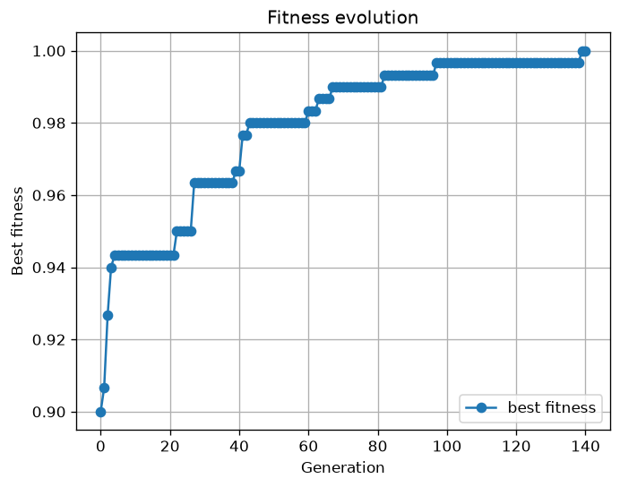

# Automated University Class Scheduling with a Genetic Algorithm

Timetabling for a technical university, solved as a constrained combinatorial optimization
problem. The scheduler assigns every class to a *(day, room, start hour)* triple so that no
professor, student group, or room is double-booked, lab classes land in lab rooms, and room
capacity is respected.

This is the reference implementation behind a peer-reviewed conference paper (see
[Publication](#publication)).

On the bundled 30-class instance the algorithm reaches a **conflict-free schedule
(fitness = 1.0) in ~140 generations, under 3 seconds** on a laptop CPU.

---

## Problem

Given professors, courses, rooms, student groups, and the classes that connect them, produce a
weekly timetable over a 5-day × 12-hour grid.

**Decision variables.** For each class *i*: day *d<sub>i</sub>* ∈ [0,5), room *r<sub>i</sub>* ∈ [0, |R|),
start hour *s<sub>i</sub>* ∈ [0, 12 − duration<sub>i</sub>].

**Constraints.** Five criteria are evaluated per class in `model/Criteria.py`. Each is either
satisfied (score 1) or violated (score = its weight), and the fitness is the mean over all
`5 × |classes|` checks:

| # | Criterion | Weight when violated | Type |
|---|---|---|---|
| 1 | No two classes share the same room and slot | 0.0 | hard |
| 2 | Room capacity ≥ total size of the assigned student groups | 0.5 | soft |
| 3 | Lab classes are placed in lab rooms | 0.5 | soft |
| 4 | No professor teaches two classes in the same slot | 0.0 | hard |
| 5 | No student group attends two classes in the same slot | 0.0 | hard |

Hard constraints earn zero credit when violated, so the search is pushed hard away from
double-bookings; the two resource-fit criteria are soft and still earn half credit, which keeps
the fitness landscape smooth enough for the GA to climb. `fitness = 1.0` means every criterion
holds for every class — a fully feasible timetable — and nothing less is accepted as a solution.

The "class fits inside the day" requirement is not a criterion: the encoding draws start hours
from `[0, 12 − duration]`, so it holds by construction.

---

## Results

Run on `config/GaSchedule.json` (30 classes, 6 rooms, 10 professors, 5 groups, seed 42):

| Metric | Value |
|---|---|
| Generations to feasibility | 140 |
| Wall-clock time | 2.3 s |
| Final fitness | 1.000 |
| Population size | 100 |

The run writes two artifacts to `output/`: `GaSchedule.html` (the timetable, one table per room)
and `GaSchedule_fitness.png` (best fitness per generation).



The curve is characteristic of a steady-state GA on a constrained problem: fast early gains as
room and lab violations are cleared, then long plateaus while the search shuffles classes to
resolve the last few professor/group collisions.

---

## Quick start

```bash
git clone https://github.com/semthedev/automated-optimal-class-scheduling.git
cd automated-optimal-class-scheduling

python -m venv .venv && source .venv/bin/activate   # Windows: .venv\Scripts\activate
pip install -r requirements.txt

cd GA
python scripts/ConsoleApp.py ../config/GaSchedule.json --seed 42
```

Reproduce the numbers in [Results](#results) exactly:

```bash
python scripts/ConsoleApp.py ../config/GaSchedule.json --headless --seed 42 --out-dir ../output
```

### CLI options

| Flag | Default | Meaning |
|---|---|---|
| `config` | `config/GaSchedule.json` | path to the instance file |
| `--out-dir` | `output` | where the HTML timetable and fitness plot go |
| `--seed` | none | RNG seed for a reproducible run |
| `--max-repeat` | `9999` | stop after N generations without improvement |
| `--min-fitness` | `1.0` | stop as soon as this fitness is reached |
| `--headless` | off | write files only — no plot window, no browser (CI-safe) |

Requires Python 3.10+.

---

## Algorithm

A steady-state genetic algorithm with elitism (`algorithm/GeneticAlgorithm.py`).

- **Encoding** — each class contributes three integer genes `(day, room, start_hour)`, so a
  chromosome is a flat list of length `3 × |classes|`.
- **Selection** — random parent pairs from the non-elite portion of the population.
- **Crossover** — multi-point crossover at class boundaries, so genes for one class stay together.
- **Mutation** — reassigns the day, room, or start hour of randomly chosen classes.
- **Replacement** — steady-state: only `replaceByGeneration` individuals are replaced per
  generation; the `trackBest` fittest chromosomes are protected as elite.
- **Termination** — `fitness ≥ min_fitness`, or no improvement for `max_repeat` generations.

| Parameter | Default | Meaning |
|---|---|---|
| `numberOfChromosomes` | 100 | population size |
| `replaceByGeneration` | 8 | individuals replaced per generation |
| `trackBest` | 5 | elite size |
| `numberOfCrossoverPoints` | 2 | crossover points |
| `mutationSize` | 2 | classes touched per mutation |
| `crossoverProbability` | 80% | |
| `mutationProbability` | 3% | |

`scripts/ConsoleAppDEAP.py` runs the same problem through the [DEAP](https://deap.readthedocs.io/)
framework (`ga/` package) as a cross-check on the hand-written implementation.

---

## Instance format

An instance is a JSON array of tagged objects. Order does not matter — the parser groups by tag
and resolves `class` references after professors, courses, rooms, and groups are loaded.

```json
[
  { "prof":   { "id": 1, "name": "A. Ivanov" } },
  { "course": { "id": 4, "name": "Programming in Python" } },
  { "room":   { "name": "L-301", "lab": true,  "size": 30 } },
  { "group":  { "id": 1, "name": "CS-21", "size": 28 } },
  { "class":  { "professor": 1, "course": 4, "lab": true, "duration": 2, "group": 1 } }
]
```

| Tag | Fields |
|---|---|
| `prof` | `id`, `name` |
| `course` | `id`, `name` |
| `room` | `name`, `lab` (bool), `size` (capacity) |
| `group` | `id`, `name`, `size` |
| `class` | `professor` (id), `course` (id), `lab` (bool), `duration` (hours), `group` / `groups` (id or list of ids) |

The grid is 5 days × 12 hours, set in `model/Constant.py`.

---

## Layout

```
automated-optimal-class-scheduling/
├── config/
│   └── GaSchedule.json          # sample instance (30 classes, 6 rooms, 5 groups)
├── GA/
│   ├── algorithm/
│   │   └── GeneticAlgorithm.py  # steady-state GA with elitism
│   ├── ga/                      # DEAP-based variant
│   │   ├── config.py            # instance loader (singleton)
│   │   ├── representation.py    # encode / decode chromosome ↔ schedule
│   │   ├── fitness.py           # objective
│   │   ├── operators.py         # crossover and mutation
│   │   └── toolbox.py           # DEAP toolbox wiring
│   ├── model/
│   │   ├── Configuration.py     # JSON instance parser
│   │   ├── Constant.py          # grid size (days, hours)
│   │   ├── Criteria.py          # the five constraints
│   │   ├── Schedule.py          # chromosome: slots, fitness, GA operators
│   │   ├── Reservation.py       # (day, room, hour) ↔ slot index
│   │   ├── Course.py, CourseClass.py, Professor.py, Room.py, StudentsGroup.py
│   ├── scripts/
│   │   ├── ConsoleApp.py        # entry point
│   │   └── ConsoleAppDEAP.py    # DEAP entry point
│   └── utils/
│       └── HtmlOutput.py        # renders the timetable as HTML
└── docs/                        # system analysis and design documents (Russian)
```

---

## Publication

> Khamdamov S. **Development of an Automated Information System for Scheduling in Technical
> Universities Based on a Genetic Algorithm.** // *Artificial Intelligence in Automated Control
> and Data Processing Systems (IIASU'24)*: Proceedings of the III All-Russian Scientific
> Conference, Moscow, October 30 – November 1, 2024. Vol. 2, pp. 379–387.

The paper covers the domain analysis, the mathematical formulation of the optimization problem,
the justification for choosing a genetic algorithm over exact methods, and the evaluation. The
supporting design artifacts (parametric model, IDEF0/IDEF3 process diagrams, BPMN 2.0 data
preparation model, Power Designer data model) live in `docs/` and are in Russian.

---

## License

MIT
